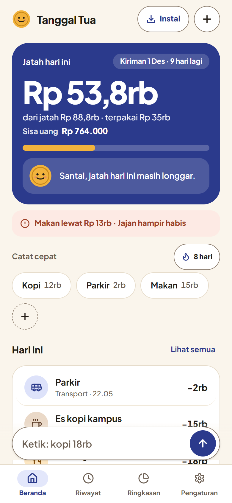
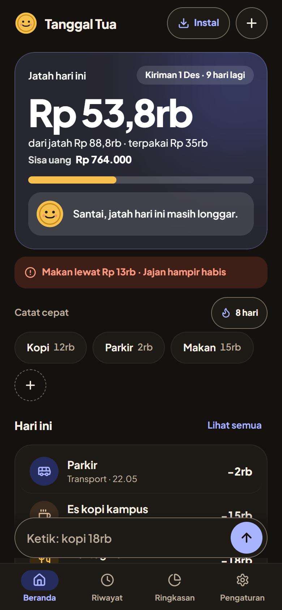
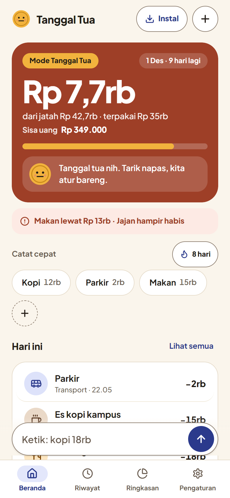
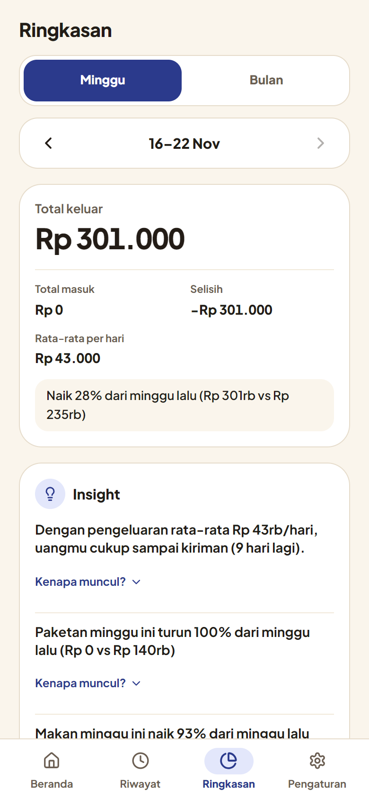
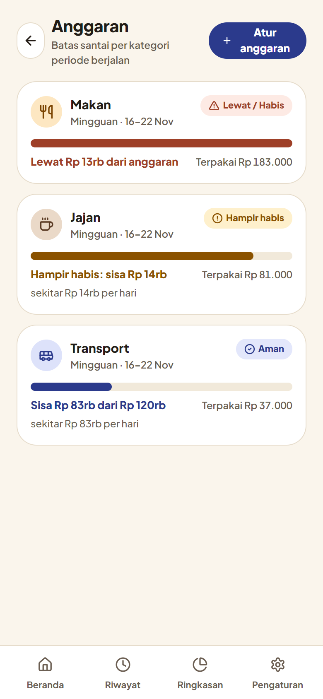
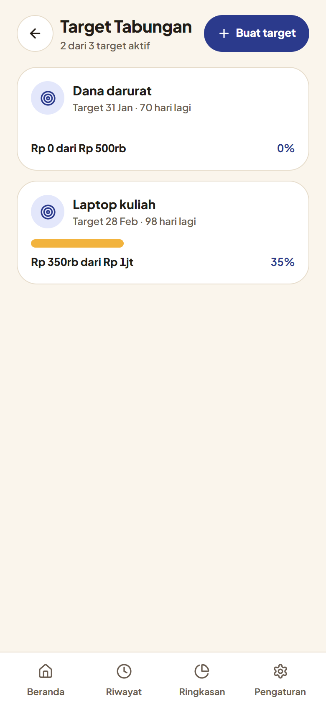
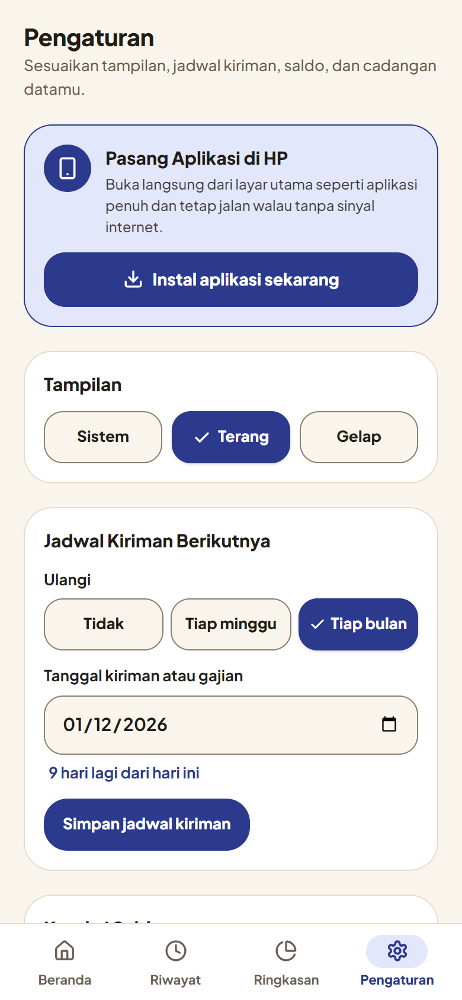
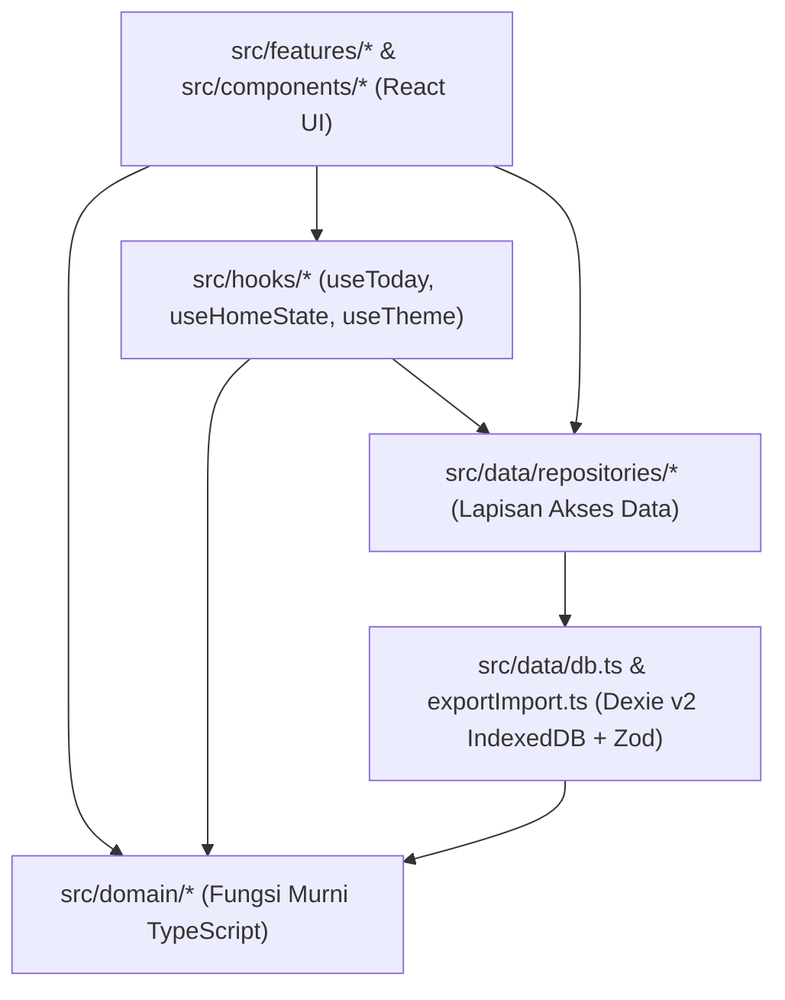

# Tanggal Tua

> Bertahan sampai kiriman berikutnya.

[](CHANGELOG.md)
[](LICENSE)

Aplikasi pencatat keuangan harian (*Progressive Web App*, *mobile-first*, *local-first*) untuk mahasiswa dan Gen Z di Indonesia yang langsung menjawab pertanyaan praktis setiap hari: **"Hari ini aku masih boleh jajan berapa?"**

## Mengapa Dibuat

Kebanyakan orang berhenti mencatat pengeluaran dalam hitungan minggu karena dua masalah sederhana: mencatat satu transaksi terasa seperti pekerjaan entri data, dan layar utama aplikasi keuangan hanya menyajikan rekap historis yang tidak membantu mengambil keputusan hari ini. **Tanggal Tua** menampilkan satu angka keputusan **sisa jatah harian** dari saldo yang masih dipegang dibagi sisa hari menuju kiriman atau gajian berikutnya, dipadukan dengan input chat 5 detik, pengingat lokal tanpa menghakimi, anggaran kategori, dan target tabungan yang berjalan 100% lokal di perangkatmu.

## Tangkapan Layar

*Seluruh tangkapan layar memakai data fiktif pada viewport mobile `390x844`.*

| Beranda (Terang) | Beranda (Gelap) | Mode Tanggal Tua |
| :---: | :---: | :---: |
|  |  |  |

| Ringkasan & Insight | Anggaran Kategori | Target Tabungan | Pengaturan |
| :---: | :---: | :---: | :---: |
|  |  |  |  |

## Fitur Utama

- **Jatah Harian & Total Sisa Uang:** Menghitung jatah otomatis menuju kiriman berikutnya (mendukung siklus sekali, mingguan, dan bulanan) dengan formula stabil sepanjang hari serta menampilkan total sisa uang secara langsung.
- **Mode Tanggal Tua Tanpa Menghakimi:** Saat jatah menipis (`<= Rp 30.000` atau `<= 20%`), hero beralih ke warna terakota hangat bersama pesan dukungan maskot **Receh** (`smile`, `flat`, `oops`, `sleepy`, `cheer`, `wink`).
- **Catat Cepat 5 Detik & Template:** Ketik seperti chat (`kopi 18rb`, `bakso 2 porsi 20rb`, `transfer dari ortu 1jt`, `+500rb freelance`, `parkir 2rb kemarin`) dengan pratinjau langsung, chip template satu ketuk, dan tombol **Batalkan** selama 5 detik.
- **Target Tabungan (`/target`):** Pisahkan uang untuk hingga 3 target aktif sekaligus lengkap dengan proyeksi tabungan harian, setor/tarik saldo, serta opsi tandai terbeli atau arsip dengan pengembalian otomatis. Transaksi tabungan tidak mengotori `spentToday` maupun grafik belanja.
- **Anggaran per Kategori (`/anggaran`):** Batas santai mingguan atau bulanan per kategori pengeluaran dengan peringatan lembut di Beranda, toast ambang 80%/100%, dan ringkasan di `/ringkasan`.
- **Ringkasan & Insight Lokal (`/ringkasan`):** Total keluar/masuk/selisih/ditabung, perbandingan adil terhadap jumlah hari yang sama di periode lalu, diagram donut & grafik batang harian, serta maksimal 3 insight berbasis aturan lengkap dengan penjelasan **"Kenapa muncul?"**.
- **Streak Mencatat & Pengingat Lokal:** Pil streak ramah dengan penanda **"Hari ini tidak ada pengeluaran"**, pengingat dalam app, ekspor jadwal harian `.ics` untuk aplikasi kalender bawaan, pengingat cadangan 30 hari, panduan instal Safari iOS, serta status penyimpanan permanen browser.
- **100% Lokal, Tanpa Server & Offline Penuh:** Data disimpan di IndexedDB (`Dexie v2`), bebas akun dan bebas permintaan jaringan pihak ketiga, dengan ekspor/impor JSON (mode *Gabungkan* / *Ganti semua*) dan CSV UTF-8 BOM.

## Cara Menjalankan

Prasyarat: **Node.js >= 20** dan **pnpm**.

```bash
# 1. Pasang dependensi
pnpm install

# 2. Jalankan server pengembangan
pnpm dev

# 3. Jalankan unit & component test
pnpm test

# 4. Periksa tipe TypeScript & linter
pnpm typecheck
pnpm lint

# 5. Bangun bundel produksi & pratinjau lokal
pnpm build
pnpm preview

# 6. Jalankan seluruh suite E2E & audit aksesibilitas Playwright
pnpm test:e2e
```

## Arsitektur Singkat



- **`src/domain/`**: Seluruh logika bisnis deterministik (`allowance`, `summary`, `insights`, `streak`, `goals`, `savings`, `budgets`, `reminder`, `banners`, `parser`) murni tanpa React ataupun Dexie.
- **`src/data/`**: Skema Dexie v2 (`transactions`, `categories`, `templates`, `settings`, `goals`, `dayMarks`, `budgets`), migrasi atomik dari v1 (`0.3.x`), repositori, serta ekspor/impor JSON/CSV bervalidasi Zod.
- **`src/features/` & `src/components/`**: UI semantik dengan lazy-loading pada rute sekunder (`/riwayat`, `/ringkasan`, `/anggaran`, `/target`, `/pengaturan`) dan audit kontras WCAG 2.2 AA (`src/styles/contrast.test.ts`).

## Keputusan Teknis Penting

1. **Tabungan Di Luar `spentToday` & Ringkasan Belanja:** Menabung memengaruhi total sisa uang bebas, tetapi bukan pengeluaran konsumsi hari ini agar jatah jajan dan grafik Ringkasan tetap akurat.
2. **Banner Beranda Tunggal Berbasis Prioritas:** Maksimal satu banner yang tampil di Beranda (`kiriman > pengingat harian > anggaran > panduan iOS > cadangan`) menjaga layar utama tetap lega dan fokus.
3. **Pengingat Lokal + Kalender `.ics` Tanpa Push API:** Aplikasi sengaja tidak memakai Push Notification, Periodic Background Sync, atau Notification Triggers demi menjaga arsitektur murni tanpa server maupun permintaan izin yang agresif.
4. **Rilis Stabil Langsung ke `1.0.0`:** Mencakup seluruh lingkup fitur inti lokal-first beserta garansi migrasi aman dari versi `>= 0.3`. Detail lengkap tercatat di [docs/DECISIONS.md](docs/DECISIONS.md).

## Batasan yang Diketahui

- Satu baris input catat cepat menerima satu transaksi sekaligus (dua item dalam satu kalimat perlu dicatat terpisah).
- Pencatatan via suara sengaja ditunda ke rilis berikutnya karena membutuhkan keputusan privasi mode lokal serta parser angka lisan Bahasa Indonesia.
- Data tersimpan secara lokal di browser perangkat pengguna; pembersihan cache/site data browser tanpa cadangan dapat menghapus catatan jika penyimpanan permanen tidak diaktifkan oleh sistem.

## Roadmap & Kualitas

- Dokumentasi spesifikasi lengkap: [docs/SPEC.md](docs/SPEC.md)
- Catatan keputusan teknis: [docs/DECISIONS.md](docs/DECISIONS.md)
- Studi kasus pengembangan: [docs/CASE-STUDY.md](docs/CASE-STUDY.md)
- Laporan kualitas & audit Lighthouse/kontras: [docs/QUALITY.md](docs/QUALITY.md)
- Daftar uji QA perangkat nyata: [docs/QA-CHECKLIST.md](docs/QA-CHECKLIST.md)
- Rencana jangka panjang: [docs/ROADMAP.md](docs/ROADMAP.md)

## Lisensi

Didistribusikan di bawah [MIT License](LICENSE).
