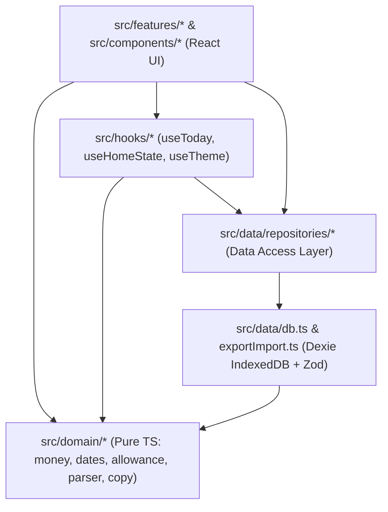

# Tanggal Tua

> Bertahan sampai kiriman berikutnya.

Aplikasi pencatat keuangan harian (*Progressive Web App*, *mobile-first*, *local-first*) untuk mahasiswa dan Gen Z di Indonesia yang menjawab satu pertanyaan praktis setiap hari: **"Hari ini aku masih boleh jajan berapa?"**

## Mengapa Dibuat

Kebanyakan orang berhenti memakai aplikasi pencatat pengeluaran dalam beberapa minggu karena mencatat setiap transaksi terasa seperti pekerjaan input data, dan layar utamanya hanya menampilkan laporan masa lalu. **Tanggal Tua** membalik pendekatan tersebut: layar utama langsung menampilkan **sisa jatah harian** berdasarkan saldo yang dipegang dan sisa hari menuju tanggal kiriman atau gajian berikutnya, sementara pencatatan cukup diketik seperti chat singkat (`kopi 18rb`, `parkir 2rb`, `kiriman ortu 1,5jt`) atau satu ketukan chip template.

## Fitur Utama (MVP)

- **Sisa Jatah Harian Otomatis:** Menghitung plafon harian dari saldo aktif dibagi sisa hari menuju kiriman berikutnya. Pengeluaran hari ini hanya mengurangi sisa hari ini; kelebihan belanja otomatis menyesuaikan jatah hari-hari berikutnya.
- **Mode Tanggal Tua Tanpa Menghakimi:** Saat jatah harian di bawah ambang batas (Rp 30.000) atau tersisa ≤ 20%, tampilan beralih ke warna terakota hangat dengan pesan maskot **Receh** yang menenangkan.
- **Catat Cepat 5 Detik:** Ketik gaya chat (`kopi susu 18.000`, `bakso 2 porsi 20rb`, `+500rb freelance`, `kopi 18rb kemarin`) dengan pratinjau langsung dan tombol **Batalkan** selama 5 detik.
- **Template Satu Ketuk:** Simpan pengeluaran rutin dalam sekali ketuk, diurutkan otomatis berdasarkan frekuensi pemakaian.
- **100% Lokal & Berfungsi Offline (PWA):** Seluruh data tersimpan di IndexedDB perangkat pengguna tanpa akun, tanpa server, dan tanpa pelacak pihak ketiga.
- **Ekspor & Impor Data Penuh:** Cadangkan data ke format JSON berversi (mode *Gabungkan* atau *Ganti semua*) maupun CSV (UTF-8 dengan BOM yang langsung rapi saat dibuka di Excel).

## Cara Menjalankan

Prasyarat: **Node.js >= 20** dan **pnpm**.

```bash
# Pasang seluruh dependensi
pnpm install

# Jalankan server pengembangan
pnpm dev

# Jalankan seluruh pengujian unit dan komponen
pnpm test

# Periksa tipe TypeScript dan aturan linter
pnpm typecheck
pnpm lint

# Bangun bundel produksi
pnpm build
```

## Arsitektur



- **`src/domain/`**: Fungsi TypeScript murni dan deterministik (tanpa ketergantungan pada React atau IndexedDB) beserta pengujian unit menyeluruh.
- **`src/data/`**: Skema Dexie v1, repositori, data awal (*seed*), serta modul ekspor/impor tervalidasi Zod.
- **`src/features/` & `src/components/`**: Antarmuka pengguna semantik dengan token CSS yang telah teruji kontras WCAG 2.2 AA pada tema terang maupun gelap.

## Keputusan Teknis Penting

1. **Rumus Jatah Harian Stabil Harian:** `dailyAllowance = floor((currentBalance + spentToday) / daysLeft)`. Dengan menambahkan kembali `spentToday` sebelum dibagi `daysLeft`, plafon jatah harian tidak berubah-ubah ketika pengguna mencatat pengeluaran sepanjang hari itu.
2. **Koreksi Saldo via Transaksi Adjustment:** Perubahan saldo manual tidak menimpa `openingBalance`, melainkan mencatat transaksi bertipe `adjustment` (+/−) agar riwayat saldo tetap utuh dan teraudit.
3. **Kontras Warna Terverifikasi Matematis:** Token warna kategori, permukaan kartu hero, serta batas komponen interaktif diuji otomatis terhadap rumus luminansi relatif WCAG 2.x.

## Batasan yang Diketahui

- Pada versi MVP (P0), satu baris input catat cepat hanya menerima satu nominal transaksi (input seperti `es teh 4rb dan parkir 2rb` akan meminta pencatatan satu per satu; pemisahan otomatis masuk ke roadmap P1).
- Karena data disimpan murni di browser perangkat lokal, penghapusan data situs pada pengaturan browser dapat menghapus catatan jika pengguna belum melakukan ekspor JSON/CSV.

## Roadmap

- **P0 (MVP - Selesai):** Onboarding, Beranda 6 State, Parser Catat Cepat, Template Satu Ketuk, Form Transaksi Lengkap, Riwayat Harian, Pengaturan & Ekspor/Impor, PWA Offline.
- **P1:** Catatan patungan dan utang teman, transaksi berulang otomatis, kategori kustom, pencarian riwayat, ringkasan bulanan, pemisahan multi-nominal dalam satu input.
- **P2:** Input suara Bahasa Indonesia (`Web Speech API`) dan enkripsi cadangan lokal.

## Lisensi

Didistribusikan di bawah [MIT License](LICENSE).
